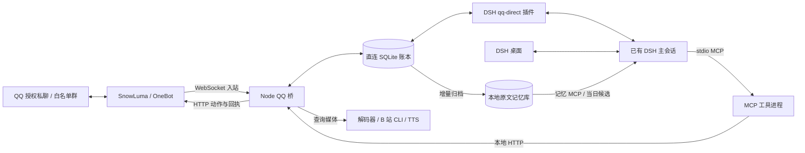

# DSH QQ 直连 · 架构原理与跨机复建手册

返回[项目 README](../README.md)，或查看 [DSH 挂载样例](./dsh-profile.example.yml)。

## 1. 系统目标与适用边界

三种入口共享一个**明确绑定的现有 DSH 主会话**：DSH 桌面、操作者授权的 QQ 私聊和白名单 QQ 群。主会话沿用原来的预设、对话历史、记忆和 DSH 工具。桥保存消息来源和回复目标，授权操作者在 QQ 里请求查看电脑文件时，智能体可以先追问、拒绝或按原权限执行，操作过程与对话保留在同一会话。

### 核心链路与可选扩展

| 范围 | 能力 |
|---|---|
| 核心链路 | QQ 私聊与白名单群接入既有 DSH 会话，保留渠道、发言人与引用。使用 SQLite 投递账本做文本收发、去重和回执，发送前校验权限与目的地。 |
| 可选择性采纳 | 群聊主动唤醒与随机回访、梗库和收藏表情。 |
| 可选择性采纳 | 看图、长图切片、转发、视频预览、B 站内容、语音以及本机文件收发。 |
| 可选择性采纳 | 独立长期记忆库、头像、签名和 QQ 空间。 |

可选扩展的源码随项目提供，可以按需求选用。搭建时先验证核心的文本直连，再逐项配置所需依赖和权限。用于投递与回执的 SQLite 账本属于核心链路，长期记忆库可以另行接入。

复建时应保持下列约束。

1. **会话连续性。** 所有受管入口绑定同一个指定的 DSH `sessionId`。身份、工作目录和预设应通过 DSH 的当前会话目录核对。身份失配时停止直连投递。
2. **渠道归属。** 会话 ID 表示智能体的会话，QQ `channel` 表示本条消息的会话场景。一个主会话可以包含多个 `channel`，每轮回复去向来自该轮触发记录。
3. **执行归属。** 带 @、引用或提及的文本属于上下文。电脑、账号写入、外发文件等权限由运行时依据可信事件元数据判断。
4. **记忆与送达。** 原始消息、模型上下文、待发送请求和已确认发送属于不同记录。OneBot 成功响应表示网关确认受理，客户端阅读状态另计。
5. **主动参与（可选扩展）。** 群聊评分和随机时点只负责何时开启一个查看回合。智能体可以回复、用表情或语音，也可以结束本轮。

本机原型针对个人环境与有限白名单。共享主会话适合跨入口衔接，跨账号互不信任、不同组织的数据隔离和匿名对外服务需要另行设计。

## 2. 组件拓扑与版本基准



| 组件 | 本机核对版本 | 职责与迁移提示 |
|---|---|---|
| DeepSeek Harness 桌面 | `0.2.2-rc.1` | 托管已有会话、工具执行和持久事件。升级后重点回归插件装载、回合钩子及事件结构。 |
| Node.js | `24.21.0` | 运行 ESM 桥和 MCP。代码使用 `node:sqlite`。桥包声明 `>=22.13.0`，复建优先用已验证的 Node 24。 |
| SnowLuma | `1.14.22` | 提供 QQ 账号接入、OneBot WebSocket 事件和 HTTP 动作。此处网关采用本机独立安装。 |
| `@snowluma/sdk` / `@snowluma/mcp` | `1.14.9` / `1.14.10` | 以锁文件为准。桥的安装脚本会应用项目的 SDK 兼容补丁。 |
| DSH API 客户端 / MCP SDK | `@deepseek-ai/dsh-host-apiproxy 0.1.1-rc.2` / `@modelcontextprotocol/sdk 1.30.0` | 前者用于本地 DSH RPC 与事件流，后者用于 stdio 工具服务。 |
| Python | `3.12.1` | QQ 原文增量入库、记忆服务及空间候选。图像分段还需要能导入 Pillow 的 Python。 |
| 可选媒体依赖 | FFmpeg、B 站 CLI、本机 TTS 服务 | 文本接入可以先独立搭建。视频、B 站预览、语音分别接入和验收。 |

公共协议参考使用 OneBot v11 的消息事件与基础动作说明。QQ 空间、头像、个性签名和部分收藏表情动作由具体网关提供。MCP 在本机用 stdio，管理接口只绑定回环。 [OneBot v11 消息事件](https://github.com/botuniverse/onebot-11/blob/master/event/message.md) · [OneBot v11 公共动作](https://github.com/botuniverse/onebot-11/blob/master/api/public.md) · [SnowLuma](https://github.com/SnowLuma/SnowLuma) · [MCP 传输规范](https://modelcontextprotocol.io/specification/2025-11-25/basic/transports) · [Node 24 SQLite](https://nodejs.org/docs/latest-v24.x/api/sqlite.html)

## 3. 目录与源码定位

下表以项目工作区为根。`memory-app/` 是本文为独立记忆组件使用的示意目录，复建时可放在别处。

```text
workbench/
  plugins/
    qq-direct.mjs                 DSH 主会话投递、回合权限、回复工具
    qq-direct-context.mjs         模型所见 QQ 消息的紧凑渲染
    dsh-token-reporter.mjs        向本地桥报告桌面 DSH 端口及认证入口
  qq-bridge/
    package.json / package-lock.json
    config.example.json           配置模板
    config.json                   目标机私有配置
    src/                          桥、媒体、MCP、账号资料和归档适配器
    public/console.html           本地控制台页面
    dsh/agent-presets/             兼容旧 QQ 会话的预设与场景守卫
    scripts/                      测试、启动、同步和部署辅助
    assets/self-avatars/          管理员自行放置的批准图片
    state/                        本机运行态，首次启动创建
  tools/qq-launcher/               Windows 启停入口与健康检查
  memory-app/                      独立原文库与 MCP 服务
```

| 实现位置 | 入口或关键职责 |
|---|---|
| `qq-bridge/src/bridge.js` | `main`、`handleIncoming`、`startConsoleServer`、`findMessageMedia`、`fetchMediaData`、`handlePokeNotice`、OneBot 收发、语音队列、历史兼容及 RPC 事件处理。 |
| `qq-bridge/src/bridge-config.js` | `loadBridgeConfig`、`normalizeOwnerQQ`、`readJsonSafe`。兼容 UTF-8 BOM，合并旧配置和新增默认值。 |
| `qq-bridge/src/qq-message.js` | `segmentsToText`。解析 `text`、`at`、`reply`、表情、图片、文件、语音、视频、卡片和转发段。 |
| `qq-bridge/src/direct-runtime.js` | `createDirectRuntime`。返回接收、发送、写入、空间机会和启动函数，负责直连入账、群聊决策、发送队列、归档唤醒。 |
| `qq-bridge/src/direct-store.mjs` | `directEvent`、`replyTarget`、`openDirectStore`。提供稳定身份、账本、原消息查询、转发出处查询及回执状态机。 |
| `qq-bridge/src/dsh-client.js` | `NodeApiClient`。连接 DSH 本地鉴权与 RPC，维护 `/api/remote.mux` 的 `session/follow` 订阅。 |
| `plugins/qq-direct.mjs` | `apply`、`agent/pre-step`、`session/event`、定时 `pump`、回合工具 guard。提供 `qq_direct_recent`、`qq_direct_reply`、`qq_direct_revisit`。 |
| `plugins/qq-direct-context.mjs` | `renderQQContext`。保留来源与正文，省略空字段，分开渲染普通消息、群查看机会和空间机会。 |
| `qq-bridge/src/mcp-snowluma-safe.js` | 把受限的 QQ 工具注册为 MCP。按需读取附件、表情、转发、近况，提供 QQ 账号工具和部分兼容路径。 |
| `qq-bridge/src/mcp-host-server.js` / `mcp-web-search-safe.js` | 可选本机管理和安全网页读取。普通群友工具白名单只开放所需能力。 |
| `message-media.js` / `forward.js` / `safe-fetch.js` | 附件定位、原消息渠道归属、转发 ID 解析、安全下载。 |
| `animation-media.js` / `animation-frames.py` / `bili-media.js` | GIF/WebP 接触图、长图切片、QQ MP4 预览和 B 站按需读取。 |
| `sticker-lib.js` / `slang-learner.js` / `qq-wake.js` | 收藏表情、备注和候选梗，群聊词项匹配与唤醒评分。 |
| `self-account.js` / `qzone-policy.js` | 已绑定账号、批准头像、资料冷却、随机发布机会与 QQ 空间的单次发布校验。 |
| `direct-memory.py` / `public-memory-client.js` | 从直连账本增量写原文库，以及向旧桥提供受限的记忆检索适配。 |
| `computer-tasks.js` / `session-rollover.js` / `unified-qq.js` / `v2-wait.js` | 旧任务委托、旧 QQ 会话续接与合并、旧等待逻辑。直连消息在 `handleIncoming` 内提前分流，原有功能留给相应兼容模式。 |
| `tools/qq-launcher/launch.mjs` / `stop.mjs` | 核对 DSH、复用或启动 SnowLuma、校验机器人账号、同步鉴权并拉起桥。启动器可识别 PID 被复用的过期锁。 |

<a name="message-flow"></a>

## 4. 消息、回合与账本

### 4.1 规范化事件

`handleIncoming` 首先以当前模式和白名单检查渠道。启用直连且处于 `reserved2` 时，对授权私聊和白名单群转入 `receiveDirect`。函数使用事件字段里的 `user_id`，保留群名片或昵称作为展示值，解析引用原作者和正文。`directEvent` 保存卡片中的标题、简介和链接及各类附件定位信息。展示给模型的引用正文、备注和附件标签仍属于外部数据。

下例为虚构的账本对象。消息 ID 可能为负数，统一当字符串传递。时间为 Unix 毫秒。

```json
{
  "id": "qq:group:20001:-42",
  "channel": "group:20001",
  "messageId": "-42",
  "senderId": "10002",
  "sender": "示例群友",
  "at": 1794200000000,
  "text": "这张长图里第二段是什么意思？",
  "quote": {"messageId":"-41","senderId":"10003","sender":"另一位群友","text":"这是刚才的截图"},
  "mentions": ["10004"],
  "media": [{"type":"image","ref":"fixture.png"}],
  "attachments": [{"kind":"image","file":"fixture.png","url":""}],
  "forwardIds": [],
  "wake": true,
  "wakeClass": "direct",
  "hints": "可选的梗或表情候选"
}
```

普通 QQ 消息使用 `qq:<channel>:<messageId>` 去重。拍一拍、查看机会和空间机会使用不同前缀的合成 ID。拍一拍没有可引用的 QQ 原消息 ID。空间机会另外包含 `opportunity: true`、`qzone: true` 和 `expiresAt`。当前实现以一个网关账号配一个账本。多账号复建应按账号分库或把账号身份纳入唯一键。

### 4.2 SQLite 的职责

本机使用 `DatabaseSync`，启用 WAL 并设定 `busy_timeout=2500`。桥和 DSH 插件都访问同一个账本。下面列出复建所需的最小表结构，完整实现还提供索引、JSON 投影与回查查询。 [Node 24 SQLite](https://nodejs.org/docs/latest-v24.x/api/sqlite.html)

```sql
PRAGMA journal_mode = WAL;
PRAGMA busy_timeout = 2500;
CREATE TABLE IF NOT EXISTS input (
  seq INTEGER PRIMARY KEY, id TEXT UNIQUE NOT NULL, channel TEXT NOT NULL,
  wake INTEGER NOT NULL, payload TEXT NOT NULL, consumed INTEGER NOT NULL DEFAULT 0
);
CREATE INDEX IF NOT EXISTS input_pending ON input(consumed, seq);
CREATE INDEX IF NOT EXISTS input_channel_seq ON input(channel, seq);
CREATE TABLE IF NOT EXISTS outgoing (
  seq INTEGER PRIMARY KEY, id TEXT UNIQUE NOT NULL, channel TEXT NOT NULL,
  payload TEXT NOT NULL, state TEXT NOT NULL DEFAULT 'pending', result TEXT
);
CREATE TABLE IF NOT EXISTS revisit (channel TEXT PRIMARY KEY, due INTEGER NOT NULL);
CREATE TABLE IF NOT EXISTS runtime (name TEXT PRIMARY KEY, payload TEXT NOT NULL);
CREATE TABLE IF NOT EXISTS context_seen (id TEXT PRIMARY KEY);
```

| 表 | 写入方与用途 |
|---|---|
| `input` | 桥写入。`INSERT OR IGNORE` 以 `id` 去重。DSH 插件只在会话事件落盘后标为 `consumed`。 |
| `outgoing` | DSH 工具写待发送记录。桥以原子 `UPDATE … RETURNING` 领走下一条并写回状态。 |
| `revisit` | DSH 记录智能体想稍后回访的群与到期时间，桥领取并校验时效。 |
| `runtime` | 桥发布可用渠道、会话 ID、暂停状态及心跳。插件发布 DSH 是否仍持有该 Agent，并持久化可选的桌面会话绑定。 |
| `context_seen` | 桌面已临时看到某条待唤醒的 QQ 消息。该记录仍可进入后续 QQ 回合。 |

### 4.3 DSH 如何接续消息

1. `qq-direct.mjs` 每约 300 毫秒检查主会话的 Agent。桥和插件各自约每 1.5 秒写心跳。QQ 回合执行前检查当前渠道是否还获准，并要求桥心跳在 10 秒内且未暂停。
2. 唤醒队列优先取 `direct`，再取 `continuation`，最后取普通机会。同级按入账序号处理。仅在主 Agent 空闲且已有待处理回合为空时调用 `agent.followup`。
3. `agent/pre-step` 按触发消息 ID 确认当前场景，给下一步附上待读群消息。桌面可以预看正在等回复的 QQ 消息，预看记录采用 `qq-preview:` 前缀，原 QQ 回合保留。当前每次读取的待处理批次上限为 250 条。
4. 在 QQ 回合收到桌面输入时，普通桌面用户消息重新进入下一轮，保持 QQ 的本轮回复目标。低优先级群唤醒会避让刚结束的桌面对话，当前留出 20 秒窗口。
5. `session/event` 收到 `user/message` 后先刷新会话持久化，再更新账本的已纳入状态。会话恢复时扫描已落盘的 QQ 事件及待处理队列，降低重启导致的重复纳入。`turn/end` 清理当前 QQ 场景。

本机记录使用 `source.kind = "qq-direct"` 和 `form = "notice"` 标识来源。当前 DSH 会话格式要求生产者拥有自己的 `kind`，应把它作为升级回归项。 [DSH 会话事件](https://github.com/deepseek-ai/deepseek-harness/blob/master/docs/subsystems/session.md) · [Super-agent 的投递实现](https://github.com/deepseek-ai/dsh-superagent-prototype/blob/main/src/app/delivery.ts)

### 4.4 如何发送与判定回执

`qq_direct_reply` 把内容、目标渠道、触发消息 ID、主会话 ID 和到期时间写进 `outgoing`。存在 DSH `callId` 时，请求键由触发消息和工具调用组成。桥再次检查当前配置、渠道、有效期及原消息归属。引用某人时，`replyTarget` 同时核对 `channel`、`messageId` 和 `senderId`。回复触发本轮的原句可以用 `replyToCurrent`，让插件填入原始标识。

```text
pending -> sending -> sent       网关明确返回成功
                   -> failed     本地校验失败或网关明确拒绝
                   -> unknown    发送结果不明
pending -> failed                原回合取消，且请求尚未被领取
restart: sending -> unknown      等人工核对，避免不确定请求自动重放
```

桥保留发送回执、时间和网关返回的消息 ID。QQ 工具负责发送用户可见内容。DSH 中间文字、工具输出和正式 QQ 气泡各自有明确去向。`unknown` 需按渠道查看网关或聊天记录，确认后再处理。跨进程网络发送无法单靠本地 SQLite 提供全局恰好一次语义。

## 5. 接口、鉴权与工具契约

### 5.1 三种通信通道

| 通道 | 典型配置 | 用途 |
|---|---|---|
| SnowLuma OneBot WS | `ws://127.0.0.1:3001` | 消息、拍一拍等事件。SDK 提供订阅与重连。 |
| SnowLuma OneBot HTTP | `http://127.0.0.1:3000` | `get_login_info`、`get_msg`、`get_image`、`get_forward_msg`、`send_private_msg`、`send_group_msg` 和网关特有账号动作。 |
| QQ 桥本地 HTTP | 示例 `http://127.0.0.1:3110` | 控制台、MCP 的只读查询及受控操作。绑定 `127.0.0.1`。 |
| DSH 本地 Web 与 WS | 桌面版实际端口由报告插件给出 | `session/list`、健康核验和旧兼容入口使用 RPC，事件订阅走 `/api/remote.mux`。 |
| DSH 至 MCP | 本地 `stdio` | 工具发现、结构化参数、返回文字及图片。MCP 子进程调用本地桥。 |

OneBot 事件协议只描述网关交互。`send_custom_face`、`set_qq_avatar`、`set_self_longnick`、`send_qzone_msg` 这些动作要核对目标网关能力。若替换网关，应先为动作名称、参数和回执写适配层。 [OneBot 公共 API](https://github.com/botuniverse/onebot-11/blob/master/api/public.md) · [SnowLuma](https://github.com/SnowLuma/SnowLuma)

### 5.2 本机鉴权顺序

- **网关账号。** HTTP/WS 配置使用网关自己的 access token。启动时通过 `get_login_info` 与本机绑定的机器人账号校验。QQ 本机登录由操作人完成。
- **DSH 桌面。** `dsh-token-reporter.mjs` 使用 `ctx.webServer.port` 和 `ctx.connection.authenticatedUrl(origin)` 写本地启动记录。桥的 `NodeApiClient.ensureAuth` 用启动令牌换 Cookie。桌面重启可更换端口和令牌，调用端需重新发现。报告文件是凭据，应限本机访问。
- **RPC 兼容。** `dsh-client.js` 把域方法映射为斜杠端点，包成 `payload.args`。`session/list` 的参数槽使用 `_request`，其他多个会话端点使用 `request`。`session/prompt` 在客户端补 `requestId`。这些是已核对版本的适配实现，升级时按目标版验证，避免把兼容层当作永远固定的协议。直连主入口在 DSH 插件内调用 `agent.followup`，RPC 仍用于鉴权、检查和旧模式。
- **桥的控制台和工具。** 管理请求经 `x-console-token` 校验。部分 MCP 工具还携带按渠道绑定的 `x-agent-token`。`agentTokenOk` 同时匹配渠道与令牌，直连渠道使用自己的授权，旧兼容模式仍检查旧活跃渠道。白名单、模式、工具开关和实际回合 guard 继续生效。
- **令牌在当前实现中的位置。** 桥的 `social-v2.json` 还保存按渠道签发的令牌和旧模式状态。直连的唤醒提示会带本轮 MCP 使用的渠道令牌，可能进入 DSH 会话日志和模型输入。跨机复建时可把令牌移到可信工具适配层，使用回合绑定查找令牌，降低文本上下文与凭据的耦合。该改法属于加固项。

### 5.3 关键 HTTP 路由

| 路由 | 功能与核心校验 |
|---|---|
| `GET /api/status`、`GET /api/presets` | 本地健康与可用预设。启动器用实际鉴权后的预设响应校验桥到 DSH 的链路。 |
| `GET /api/socialV2/recent`、`/api/socialV2/unread` | 按渠道返回消息投影。直连从账本读取，近期消息可合入已确认发言，未读视图按纳入状态计算。 |
| `GET /api/socialV2/message-detail` | 按渠道和 `messageId` 查询作者、文字、附件和转发线索。直连记录优先。 |
| `GET /api/images/message` | 参数为 `key`、`messageId`，可选 `biliPreview=true`。返回媒体条目和 Base64 图像。二代模式校验渠道令牌。 |
| `GET /api/socialV2/forward-message` | 参数为 `key`、`id`。只读取本渠道已见过的合并转发。 |
| `POST /api/authorize/read` | 供相关 MCP 查询核验渠道、模式与授权。 |
| `POST /api/socialV2/self-account` | 参数为 `key`、`operation` 及操作数据。支持只读 `status` 和受控资料操作。空间发布另验机会和当天证据。 |

### 5.4 工具怎样串在一起

1. DSH profile 挂载 `@deepseek-ai/dsh-mcp-client`，其 `serverName` 决定工具名前缀。`snowluma` 服务器里的 `qq_get_message_images` 在 DSH 中叫 `mcp__snowluma__qq_get_message_images`。白名单应使用执行期的全名。
2. DSH 原生工具 `qq_direct_recent`、`qq_direct_reply`、`qq_direct_revisit` 由 `plugins/qq-direct.mjs` 注册。它们直接查账本、排队或预约。
3. MCP 媒体和账号工具在独立进程运行，通过桥的本地接口执行。`qq_get_message_images` 把桥返回的 Base64 与 MIME 类型转成 MCP 图像块。实际模型需要支持图像输入。
4. `memory` MCP 通常挂 `search_memory` 和 `read_memory_context`，DSH 内工具名分别为 `mcp__memory__search_memory` 和 `mcp__memory__read_memory_context`。根据当前回合的工具守卫执行。
5. 旧桥还注册 `qq_get_prompt`、`qq_mark_read`、`qq_set_wake_config`、`qq_wait_for_messages`、`qq_send_burst` 等工具。迁移时可保留注册和旧配置。直连的排队、唤醒与确认发送由账本和原生工具处理。

DSH 的 `tools.guard` 属于执行期的额外拒绝条件。模型可见工具说明与实际能否执行是两层，应分别测试。 [DSH 工具管线](https://github.com/deepseek-ai/deepseek-harness/blob/master/docs/subsystems/tools.md)

<a name="features"></a>

## 6. 各功能如何实现

### 6.1 聊天、引用与群聊参与

| 功能 | 代码与机制 | 边界 |
|---|---|---|
| 文字、@、引用 | `segmentsToText` 保留文字和展示信息。`resolveReplyInfo` 查原句并校验所属群或私聊。`directEvent` 分别记录当前作者、原作者和 ID。 | 同名、同时间出现和相近关键词都可能是不同话题。实现依靠结构化归属与智能体的语境判断。 |
| 私聊 | `receiveDirect` 把获准的授权私聊标为 `direct`。`qq_direct_reply` 默认回复原渠道。 | 可选跨渠道发送应按第 8 节限制调用者与目的地。 |
| 群聊 | `qq-wake.js` 依据直接点名、引用、话题延续和时间间隔决定是否唤醒。智能体判断是否参与。 | 群里多人并行时仍需观察自然对话表现。 |
| 拍一拍 | `handlePokeNotice` 记录发送者与目标，给直连账本写合成事件。群友发起的拍一拍不触发直连唤醒。 | 合成事件无真实 QQ 消息 ID，不能作为引用目标。 |
| 主动回群 | `direct-runtime.js` 每次随机约 20–100 分钟，选择允许的群给一次机会。`qq_direct_revisit` 可预约指定群，过期机会跳过。 | 程序需要运行。停机期间的机会不补发。 |
| 多入口并发 | 桌面、直接私聊、群聊回应和被动上下文经过主 Agent 的回合管理。 | 同一会话会串行处理主要回合。长时间电脑操作可让 QQ 回复排队。 |

当前群聊评分为本地轻量规则，评分本身不调用模型。直接点名优先。取最近 8 条消息中的近期片段，比较引用关系、英文数字词或中文二元词项。90 秒内相同话题或相关直接对话可延续。普通机会受 180 秒间隔和文本信息量限制，基础概率 `0.025`，话题相关加 `0.10`，提问加 `0.05`。这些是本机试验值，复建应把概率、窗口与随机源提成可配置或可注入参数，便于确定性测试。

### 6.2 媒体与社交表达（可选扩展）

| 功能 | 核心路径 | 实现范围 |
|---|---|---|
| 看图和 QQ 表情 | `message-media.js` 记录安全定位信息。`findMessageMedia` 优先查直连账本，兼容旧缓存，或对账本中已知的旧消息调用 `get_msg` 核对渠道后恢复附件。 | 网关原消息、缓存或下载地址仍可用时才能读取。 |
| 图片安全下载 | `fetchOneBotImage` 优先用受限缓存名调用 `get_image`。公网 URL 经 `safe-fetch.js` 验证 DNS、IP 和每次重定向。已知网关本地路径须在配置的网关目录内。 | 现有路径限制单条图片输入与返回预算，普通图像按内容识别 PNG/JPEG/GIF/WebP。 |
| 动图与长图 | `animation-media.js` 调 `animation-frames.py`。GIF/WebP 取有序预览帧，长图按长边切片、相邻重叠，最多 6 段。长图切片失败时普通原图仍可用则返回原图。 | 抽样图保留代表性画面。超大图片和解码异常会降级。 |
| QQ 视频 | `previewVideo` 通过安全下载拿 MP4，当前上限 24 MiB。FFmpeg 读管道并提取开头约 12 秒的稀疏画面，输出 JPEG 拼图。 | 当前只支持可获取的 MP4 预览。音轨、全片分析、过期链接和所有 QQ 格式的自动恢复仍有缺口。 |
| 合并转发 | `forward.js` 清洗转发资源 ID、解析子消息和嵌套引用。桥按渠道核对 `forwardIds` 后调用 `get_forward_msg`。 | 子节点仍来自外部内容。嵌套深度和预览数量应有上限。 |
| B 站链接 | `bili-media.js` 识别视频 ID 或安全跟随短链。通过本机 B 站 CLI 查 `video info`。显式开启预览后读取字幕、少量弹幕和约 4 个画面时间点。 | 视频不可达、无字幕、网关或 CLI 限制时返回可取得的部分。普通收消息时不会主动处理整段媒体。 |
| 收藏表情 | `sticker-lib.js` 合并网关收藏和本地备注、标签。`directStickerHint` 按正文和引用挑少量候选，`qq_list_stickers` 查询收藏。发送走 `sendStickerV2`。 | 收藏图片识别、梗语义和候选排序仍是启发式。`qq_get_sticker_image` 是否可用取决于回合允许的工具。 |
| 梗库 | 通用 `meme-dict` 按词项查找，本群 `slang` 只取已确认条目并做基础字形归一化。 | 谐音、拆字和反讽需要语境。新梗纠正后的自动学习流程尚未完整接入直连。 |
| 语音发送 | `synthesizeVoiceToFile` 检查本机 TTS 心跳，写请求 JSON，等本机 WAV 与回执。发送采用 OneBot `record` 段。 | 音色、合成耗时和播放兼容取决于目标机。正式群已有发送回执。语音与收藏表情的直连发送默认省略引用。 |
| 本地图片、文件 | `qq_direct_reply` 的 `image` 或 `file` 分支经桥组装 OneBot 消息。图像分支校验扩展名与文件存在，文件分支拦截疑似凭据路径并限 100 MiB。无引用群文件要求显式 `broadcast`。 | 路径名过滤只是一层。跨机复建的发送权限、规范路径与批准目录见第 8 节。 |
| 收到文件 | `qq_save_file` 调用 `qq-download.js`，先验证渠道授权和原消息归属，再取第一个文件或媒体段。下载使用 `safe-fetch.js`，最多 32 MiB。 | 仅在 `state/downloads/` 内新建文件，已有文件不会覆盖。群友回合保持禁用。 |

长图和视频解码应保持限时、限体积与失败降级。当前视频命令行只把经检查的 MP4 字节喂给 FFmpeg，限制协议为 `pipe`，避免把 QQ 附件给出的 URL 直接交给解码器。将外部元数据和下载分开可缩小权限面。

本机的媒体读取最多处理一条消息里的 5 个原始媒体项，图片预览的累计返回预算为 8 MiB。单张普通图像在已知尺寸时还会检查 6400 万像素上限，Pillow 解码阶段采用更严格的像素和时间限制。长图切片属于同一个原始媒体项，仍受累计返回预算限制。

**本机 TTS 队列契约。** 在队列目录下由合成器持续写 `alive.json`，其中 `ts` 是 Unix 秒。桥要求心跳在 30 秒内，并写 `req-<唯一名>.json`，内容包含 `text`、目标 WAV 路径 `out` 与可选 `mood`。合成器将 WAV 写入输出目录，再在 `receipts/` 下写同名 JSON。成功回执为 `{"status":"completed","output":"<目标 WAV>"}`，失败回执使用 `failed` 或 `error`。桥每约 300 毫秒读回执，默认最多等 45 秒。目标机可用任意本地 TTS 实现这一协议，先用模拟 WAV 测试，再接可公开使用的音色。

### 6.3 账号资料和 QQ 空间（可选扩展）

1. `SelfAccount` 每次执行先读取 `state/self-account.json` 的绑定身份，再用 `get_login_info` 校验当前登录的机器人账号。管理端启用后才接受受控动作。
2. 头像使用 `qq_set_self_avatar`。参数为批准目录 `assets/self-avatars/` 中的图片 ID。读文件时校验文件名、真实路径、符号链接、硬链接数、文件大小与 PNG/JPEG/WebP 内容。最终调用 `set_qq_avatar`。本机批准图限制为 4 MiB。
3. 签名使用 `qq_set_self_signature`，最终调用 `set_self_longnick`。最多 100 个字符，单行，保留隐私与控制字符校验。头像和签名分别使用 24 小时冷却。旧兼容工具还支持本账号昵称和群名片，正式资料动作以实际允许的工具为准。
4. `QzonePolicy` 使用上海自然日。当前每个自然日随机选择是否提供机会，并在 10:00–22:00 范围取时点。默认选择概率为 65%。桥约每分钟复查，在 23:00 前找到有效候选时才入账。授权私聊对应的直连场景收到独立机会回合，机会至多 30 分钟且不跨日。
5. `qzone_today.py` 只读原文库，按当天记录取有限的候选摘录，最多 6 条。记录时间只是筛选依据，智能体需要自己判断内容是否真发生于当天、是否属于自己的经历、是否适合给好友看。
6. 发布通过 `qq_publish_self_qzone` 提交 `opportunityId`、当天候选 `evidenceIds`、正文和可选批准图。正文最多 500 字，可含正常换行，最多附 4 张图。桥校验正文和配图后消耗机会，再把待处理状态与当日名额落盘，最后调用 `send_qzone_msg` 并传 `ugc_right: 4`，表示好友可见。网络结果不明时保留待核对状态。

空间回合在 DSH 中仅开放发布、账号状态和记忆读取。普通群回合没有空间机会凭证时，调用发布也会被桥拒绝。已有真实机会投递与模拟发布验证，正式账号未以本轮验收为目的发布测试动态。

## 7. 记忆、上下文与瘦身

### 7.1 三个存储层

- **DSH 会话日志。** 保存真正进入模型会话的用户消息、工具事件和回应。插件通过 DSH 的持久化服务确认日志落盘。历史文件格式和压缩属于 DSH。
- **直连 SQLite。** 保存已收到的 QQ 消息、仍待回复的输入和已确认的网关结果。看图、转发和近期消息优先从这里定位。QQ 事件现在单写账本，旧缓存只用于旧模式和历史回退。
- **原文记忆库。** `direct-memory.py` 只读账本，在记忆库的个体锁和事务下写 `messages`。输入游标和输出游标分别维护。`transcript` 表示收到的消息，`spoken` 表示桥确认的发言，`attempt` 表示失败或未知。内部唤醒机会不作为聊天原文归档。

记忆库通过 `UNIQUE(source, session, locator)` 去重，并保存来源、时间、角色、正文、引用和摘要指纹。现有实现维护 SQLite FTS5 文本索引，另有独立的分块和向量索引步骤。新增 QQ 原文可以先全文检索，向量更新走记忆库自己的索引流程。媒体记录主要保存定位信息。没有持续全量复制视频、附件字节和旧 QQ 历史的保证。

只复制这一个个体所需的程序与空库初始化。目标机可用自己的 `memory_v2.py`，或实现同等适配。下文给出最小替代契约。原文账本和记忆库是长期数据，清理或迁移时使用 SQLite 的一致性备份。

### 7.2 模型实际看到的内容

- 被动 QQ 消息保留原文、作者 ID、消息 ID、引用、@ 和附件。在已知的紧凑格式里省略空字段，被动消息不计算梗与表情候选。
- 唤醒回合额外带精简的对话指导、当前渠道、需要时的 MCP 令牌及候选提示。空间机会使用独立的短说明。
- `qq_direct_recent` 可按当前渠道取前文，或按消息 ID 读取原句和引用链线索。历史原文仍可从账本和记忆服务回查。
- 同一个主会话可能积累很长的历史。瘦身主要影响以后进入的 QQ 消息与工具说明。已持久化的旧历史沿用原记录，模型窗口与压缩由 DSH 管理。

固定样本对照为 30 条混合消息，QQ 包装及正文的 UTF-8 体积从 16,322 降到 9,666 字节。43 个 SnowLuma MCP 工具的描述与参数文档从 40,381 降到 37,680 字节，非描述 schema 在同一测试配置下保持一致。`bridge.js` 入口文件从 519,540 降到 502,265 字节，部分代码移入独立模块。实际模型 token、缓存命中率和延迟仍需用相同模型与流量做对照。

<a name="security"></a>

## 8. 权限设计与复建加固

### 8.1 现有权限模型

| 当前回合 | 现有处理 |
|---|---|
| DSH 桌面 | 由原会话的 DSH 预设和运行时权限管理。 |
| 核验后的授权私聊 | 可使用主会话工具。账号资料动作仍通过账号绑定、批准图片和冷却等检查。 |
| 授权操作者本人发起的群聊 | 当前插件按触发事件真实发送者 ID 识别，沿用较完整的工具权限。 |
| 其他群友发起的群聊 | `qqTools` 允许特定聊天、媒体、记忆工具。SnowLuma MCP 的 `key` 必须等于本轮群渠道。统一回复工具只接受发往原群的文字、收藏表情或语音。 |
| 随机 QQ 空间机会 | 独立 `qzoneTools` 白名单，仅允许发布、账号状态和记忆读取，MCP 渠道键与该机会一致。 |

共享记忆按授权操作者已确认的方式供智能体理解，智能体根据听众判断能否公开。工具权限、渠道校验和敏感文本拦截是额外技术边界。完整共享上下文对模型误披露的防护能力有限，应按可信个人场景使用。

<a name="security-checks"></a>

### 8.2 已实现的执行级检查与复建边界

2026-11-09 已在 **DSH 工具 guard 和桥的发送前校验两边**接入 `direct-permissions.js`。DSH 从当前回合读取身份，桥从已验证的触发记录重查发送者和渠道，两边都按参数判定。复建时沿用以下限制。

1. 群友回合只允许在原群发文字、批准收藏表情和可选语音。`format: image`、`format: file` 与跨渠道发送只允许明确授权的授权操作者回合。
2. 授权操作者回合发送的本地图片和文件须先放入 `qq-bridge/state/exports/`。两层都核验真实路径、链接、文件类型及大小，拒绝越界路径和疑似凭据文件名。该目录应由操作者管理，避免其他本机进程并发替换待发送文件。
3. `qq_save_file` 从网关核对原消息归属，检查当前渠道授权，并用限量安全下载保存到 `qq-bridge/state/downloads/`。通过 `wx` 创建新文件，防止覆盖已有文件。受管群友回合保持禁用该工具。
4. 状态、媒体、账号和 DSH 管理接口继续只绑定本机。不要把本机控制台和 OneBot 端口直接暴露给远端。跨设备连接若确有需要，另行建立身份认证、访问控制和日志边界。
5. 需要强隐私隔离时，按听众投影一轮可见的上下文、摘要、附件和记忆检索。更强隔离场景可以使用独立会话。模型判断适合控制表达方式，技术隔离适合明确约束谁能访问什么。

建议的核心拒绝逻辑如下。这里的 `ownerId` 来自本机配置，`origin` 来自已验证的账本触发记录。

```js
function authorizeDirectSend({ origin, destination, format, ownerId }) {
  const owner = origin.senderId === ownerId;
  const localFile = format === 'image' || format === 'file';
  if (!owner && (destination !== origin.channel || localFile)) return false;
  return true; // 之后还要校验当前白名单、时效、回执键及批准目录
}
```

<a name="setup"></a>

## 9. 跨电脑复建步骤

### 9.1 第一步 · 选择代码获取方式和初始范围

**有源码时**，按第 3 节复制桥源码、锁文件、DSH 插件和回归测试。使用本机示例配置创建目标机配置。保留旧项目的相关依赖声明和 SDK 补丁，不将本机 `node_modules` 或指向它的目录联接当作分发依赖。

**仅有本文时**，可独立实现四个最小模块：OneBot 接收器、SQLite 账本、DSH 插件和 OneBot 发信适配器。先把一个测试私聊的文本收发、桌面预看、回执及去重跑通。再增加一个测试群和权限守卫。媒体、账号、记忆和主动参与分别作为可选模块接入。以下搭建流程同时给出应有的接口契约。

### 9.2 第二步 · 安装依赖和核对端口

1. 在目标电脑启动 DSH。准备一段可用于测试的已有会话，记下它的**真实会话 ID**，并核对预设和工作目录。已有角色与记忆应通过目标机自身的配置迁移。
2. 安装 SnowLuma，在本机使用隔离的测试账号。核对 OneBot WebSocket 与 HTTP 是两个正确的端口。启动后先只读调用 `get_login_info`，确认网关实际绑定的机器人账号。
3. 有源码时，进入 `qq-bridge/` 用锁文件安装依赖。保留该项目 `postinstall` 的 SDK 兼容步骤，并核对脚本所需的源文件都在分发目录中。

```powershell
node --version
py -3.12 --version
npm ci
npm test
node --check .\src\bridge.js
node --check .\src\direct-runtime.js
```

**依赖安装补丁。** npm ci 会执行 scripts/patch-snowluma-sdk.mjs。脚本只在本次安装的 @snowluma/sdk 和 @snowluma/mcp 的 dist/ 目录扫描相对导入。只有实际目标存在时，才补上缺失的 .js 或 .json 后缀。这会修改本机 node_modules 内的文件。干净副本验证中，跳过安装脚本时，锁定的 SDK 在 Node ESM 下报 ERR_MODULE_NOT_FOUND。运行补丁后，SnowLumaWebSocketClient 成功导入。使用 npm ci --ignore-scripts 的操作者可先审核补丁，再手动运行 node scripts/patch-snowluma-sdk.mjs。

4. 先用本文示例配置和模拟网关完成隔离测试。只在真实账号已核对、测试群已允许且权限测试通过后，开启真实回执。

### 9.3 第三步 · 准备桥配置

以下为字段和取值示例。示例 ID 为虚构值。将 `<…>` 替换为目标机实际配置。运行测试的入口建议使用另外的状态目录或另外一份工作区副本。

```json
{
  "ownerQQ": "10001",
  "allow": { "private": ["10001"], "groups": ["20001"] },
  "deny": { "private": [], "groups": [] },
  "allowAllWhenEmpty": false,
  "consolePort": 3110,
  "dsh": { "baseUrl": "http://127.0.0.1:3080", "authToken": "" },
  "snowluma": {
    "wsUrl": "ws://127.0.0.1:3001",
    "httpUrl": "http://127.0.0.1:3000",
    "accessToken": "<由目标机私下填写>"
  },
  "directSession": { "enabled": true, "sessionId": "<目标 DSH 主会话 ID>" },
  "memory": { "enabled": false },
  "voice": { "enabled": false },
  "legacyComputerTasks": { "enabled": false },
  "socialV2": {
    "enabled": true,
    "selfAccount": { "enabled": false, "avatar": false, "signature": false, "qzone": false }
  }
}
```

`3080` 是兼容的示意回退。桌面版若由报告插件给出动态端口，桥启动时以报告的本地端口为准。`ownerQQ` 表示**操作者**，网关绑定的机器人账号是另一个配置身份。两者分别核验。

复建初次验收时关闭所有账号写入。头像、签名和空间通过模拟网关后，按需要分别开启。桥还必须实际进入 `reserved2` 模式。现有代码优先从 DSH `qq-mode` 设置命名空间读取当前模式，并保留本机 `state/mode.json` 的兼容路径。可通过控制台选择模式，随后读 `/api/status` 核对实际结果。仅写 `directSession.enabled` 无法代替模式设置。

### 9.4 第四步 · 挂载 DSH 插件和 MCP

先创建目标机的 `qq-bridge/state/` 目录并确认可写。DSH 插件会在应用阶段打开 SQLite，父目录要先存在。再按目标 DSH profile 的 `cordis.patch.yml` 机制合入以下条目。示例 `C:/QQWorkbench/` 是虚构路径。已存在同 ID 的条目时应修改原条目，避免重复挂载。

```yaml
- insert:
    - id: qq-direct
      name: 'file:///C:/QQWorkbench/plugins/qq-direct.mjs'
      config:
        sessionId: '<与桥配置完全一致>'
        database: 'C:/QQWorkbench/qq-bridge/state/direct-qq.sqlite3'
    - id: dsh-token-reporter
      name: 'file:///C:/QQWorkbench/plugins/dsh-token-reporter.mjs'
      config:
        host: '127.0.0.1'
        outPath: 'C:/QQWorkbench/qq-bridge/state/dsh-launch.json'
    - id: mcp-snowluma
      name: '@deepseek-ai/dsh-mcp-client'
      config:
        serverName: snowluma
        transport: stdio
        command: 'C:/Runtime/node.exe'
        args:
          - 'C:/QQWorkbench/qq-bridge/src/mcp-snowluma-safe.js'
```

使用本机文件 URL 挂载插件，插件文件与 `qq-bridge/` 的相对目录关系须和第 3 节一致。`qq-direct.mjs` 声明需要 `agents`、`tools`、`timer` 与 `sessionPersistence`，应装在可获得这些服务的 DSH 作用域。MCP 配置需要更新时，重开或按目标 DSH 支持的方式重载 profile。

若目标环境含兼容旧桥的预设安装器，先检查其覆盖范围。主会话使用它原有的预设，直连绑定由两端的 `sessionId` 完成。旧桥预设不能凭名称自动代替已有主会话。`DSH_TOKEN_OUT` 可覆盖报告插件的输出位置，隔离测试必须写入测试目录。

<a name="auto-follow"></a>

#### 可选：自动跟随新建的桌面主会话

默认使用两端配置里同一个 `sessionId`。若希望在指定工作区的新对话里发出首条桌面消息时接手 QQ，在 `qq-direct` 插件的 `config` 下启用：

```yaml
        followDesktop:
          cwd: 'C:/QQWorkbench'
          agentPreset: standard
```

将 `cwd` 和 `agentPreset` 替换为实际的目标工作区绝对路径和会话预设。自动跟随只接受带请求 ID 和客户端时区、且未标注外部调用者的 DSH 用户输入。还要求会话属于配置范围，是较新且非派生的顶层会话。未加载已绑定会话且账本没有已记录的创建时间时，只接受本次插件启动后创建的会话。这个筛选基于当前 DSH 桌面使用的事件字段。能模拟相同字段的受信任本地 RPC 客户端也可能触发，应把该功能限制在可信部署。

插件等正在处理的 QQ 回合结束，再写入同一个 SQLite 账本的 `runtime/session-binding`。桥和插件共享此绑定，重启后继续使用。切换期间心跳不一致时，入站消息留在账本等待。旧会话的待发请求在发往网关前被拒绝。网关已经接手的发送应以实际回执核对。

升级早期文本指针试验版时，先把两端配置中的 `sessionId` 对齐到确认过的当前会话，再同步更新桥和插件并按正常流程重载。新版的持久绑定由 SQLite 保存。若要手动选择其他会话，先等待 QQ 回合结束，再将两端 `sessionId` 改为新选定的同一个 ID 并重载。原先的持久绑定只在它记录的初始配置 ID 与当前配置一致时生效。关闭 `followDesktop` 会停止后续自动跟随，已保存的有效绑定仍可恢复。

### 9.5 第五步 · 初始化状态和启动顺序

| 文件 | 初始化方式与作用 |
|---|---|
| `state/direct-qq.sqlite3` | 桥与 DSH 插件自动建表。两端使用同一绝对路径。隔离测试要换成独立账本。 |
| `state/dsh-launch.json` | DSH 报告插件启动时生成。包含本机认证入口。 |
| `state/console-token` | 桥在未提供合法控制台令牌时本地生成。 |
| `state/social-v2.json` | 保存按渠道令牌与旧模式状态。新授权渠道在收到有效消息或生成机会时建立所需状态。 |
| `state/self-account.json` | 管理员在本机核验机器人账号后初始化 `expectedSelfId` 和空的 `last`，或在受控管理入口调用 `SelfAccount.pin(cfg)`。账户绑定值不能照抄。 |
| `state/qzone-plan.json` | 空间策略自行创建当日计划。旧实例的已消耗机会不能迁为新机会。 |
| `assets/self-avatars/` | 管理员放入可公开的 PNG/JPEG/WebP 候选图。初次部署可留空。 |

推荐启动顺序为 **DSH → SnowLuma → QQ 桥**。DSH 打开选定会话后，核对 `dsh-launch.json` 已在目标位置生成，随后启动网关并确认绑定账号，再启动桥。直接在项目根运行桥时使用已核对的 Node。既有 Windows 一键启动工具默认读取本机路径和默认网关端口，跨机复建应先替换路径和相关配置。

```powershell
node .\src\bridge.js
# 另一个 PowerShell 窗口只读核对监听端口
Get-NetTCPConnection -State Listen -LocalPort 3000,3001,3110
```

健康判断要求 QQ 网关返回正确账号、桥本地监听成功、桥到 DSH 的真实鉴权通过，同时 SQLite 中 `bridge` 和 `dsh` 心跳新鲜且 `sessionId` 一致。进程仍在只能作为初步信号。先发测试私聊文字，确认原会话和回复原渠道，之后再加入测试群。

### 9.6 按需接入记忆与媒体（可选扩展）

**最小原文记忆适配。** 目标机可以实现同等 Python 模块，而后再接 FTS 或向量检索。现有 `direct-memory.py` 使用以下接口：

```python
# 兼容契约示意。实现者按目标机的 SQLite 模式提供这些函数。
with memory.actor_lock("anan"):
    with memory.connect("anan") as destination:
        memory.add(destination, source, channel, locator, timestamp,
                   role, kind, body, refs)
        # 在同一个提交内更新相应游标
```

`connect` 至少需要提供 `metadata(key,value)` 和带 `UNIQUE(source,session,locator)` 的消息表。`add` 实现脱敏、幂等写入，并在可用时更新 FTS。迁移时使用相同的 `transcript`、`spoken`、`attempt` 类型。初次复建可以只做原文落盘与关键词查询。空间候选服务再按需实现 `{"day":"YYYY-MM-DD","candidates":[{"id":7,"excerpt":"虚构示例"}]}`，读当天记录并限制数量。记忆 MCP 应在指定的个体库上启用，别用共享的全机档案作默认查询源。

**必查路径与端口。** 以下是本机代码中的迁移点。表中的环境变量只有明确列为“现有”的才可直接使用。

| 模块 | 目标机要配置的内容 |
|---|---|
| `animation-media.js` | 安装 Pillow 的 Python 可通过 QQ_MEDIA_PYTHON 设置。FFmpeg 可通过 QQ_MEDIA_FFMPEG 设置。未设置时从 PATH 查找。 |
| `bili-media.js` | QQ_MEDIA_BILI 指向目标机 CLI。确认支持 video info、subtitle、danmaku 和 frames，用只读公开视频样本验收。 |
| `direct-memory.py` | 启用 memory.enabled，用 QQ_PYTHON 指定 Python 3.12。默认使用本仓库的 memory-app/programs，也可用 QQ_MEMORY_PROGRAMS 替换模块目录。 |
| `qzone-policy.js` | 默认使用随源码提供的候选脚本，也可通过 QQ_QZONE_EVIDENCE 选择目标机脚本。发布开关默认关闭。 |
| TTS | `voiceConfig` 和本机 TTS 服务需指向相同的队列目录与输出目录。现有代码有本机默认路径，移植时核对配置加载器是否传入语音设置，并测试真实 WAV 回执。 |
| `mcp-snowluma-safe.js` | 附件下载目录为桥下的 state/downloads/，首次使用前创建普通目录。 |
| `tools/qq-launcher/` | 本机原型使用此启动器。当前分发候选以手动启动顺序为准，无需复用原机器的启动脚本。 |

## 10. 隔离验收、排障与回滚

### 10.1 最小模拟输入与网关动作

在隔离 OneBot WebSocket 注入下面的虚构事件。正常私聊事件还会带网关提供的其他字段，解析器以实际规范为准。

```json
{
  "time": 1794200000,
  "self_id": 10004,
  "post_type": "message",
  "message_type": "private",
  "message_id": -101,
  "user_id": 10001,
  "sender": {"user_id":10001,"nickname":"示例操作者"},
  "message": [{"type":"text","data":{"text":"测试暗号是蓝鲸"}}]
}
```

模拟网关至少提供 `get_login_info`、`get_msg`、`send_private_msg`、`send_group_msg`。成功写入返回类似 `{"status":"ok","retcode":0,"data":{"message_id":-501}}`。媒体测试可模拟 `get_image`、`get_forward_msg`，账号测试模拟 `set_qq_avatar`、`set_self_longnick`、`send_qzone_msg`。模拟测试保留实际请求参数，检查群聊或私聊类型、`reply`/`at`、接收账号和状态机。

### 10.2 回归命令与观察点

```powershell
node .\scripts\test-direct-qq.mjs
node .\scripts\test-direct-media.mjs
node .\scripts\test-direct-self-account.mjs
node .\scripts\test-audit-bridge.mjs
node .\scripts\test-mux-reconnect.mjs
```

| 场景 | 验收条件 |
|---|---|
| 相同昵称、交错话题 | 两条消息分别入账。回复错误作者与跨群引用被拒绝。正确回复落在原群。 |
| QQ 先到，桌面立刻接话 | QQ 消息先在桌面下一轮可见，等回复的 QQ 原回合保持待处理。 |
| 活跃桌面与群聊消息竞争 | 低优先级群消息延后。QQ 直接点名可排队，回复去向仍绑定原渠道。 |
| 停桥、重启、重复事件 | 同一 QQ 原消息只入账一次。`sending` 转未知，重启后不会自行重放。 |
| 图、转发和视频 | 相同渠道可读，跨渠道请求拒绝。过期链接或未知格式可降级。合并转发的子消息不改变来源授权。 |
| 群友和授权操作者权限 | 正确账号能触发预期能力。群友本地文件、跨渠道发送和电脑操作的参数级用例全部拒绝。 |
| 动态机会 | 同一自然日最多一条。跨渠道、过期、虚构证据和重复发布失败。正文或配图无效时不提前消耗机会。先用模拟网关。 |
| 记忆入库 | 授权操作者发来的原话与桥确认的发言各有独立记录，发送失败标 `attempt`，原始引用可回查。 |

原工作区的旧 `computer-tasks` 有一项回归曾失败，涉及兼容任务通知里的本地结果。公开复建应把旧任务模块和直连模块分别验收，优先使用直连原回合的工具路径。

### 10.3 常见故障

| 表现 | 优先检查 |
|---|---|
| 启动器报“启动未完成”，网关端口在、控制台端口不在 | 查看桥标准错误和启动记录。检查入口、依赖和 `bridge.lock`。当前启动器会验证锁中的进程号是否被更新的系统进程复用。 |
| 控制台端口 `EADDRINUSE` | 核对端口实际属主。正在运行的正确桥应复用。其他进程应由操作者识别后处理。 |
| DSH 重启后桥显示鉴权失败 | 核对报告文件是否是当前 DSH 产生的，以及启动器是否已重新同步本地鉴权。 |
| QQ 能收到但主会话不响应 | 核对 `reserved2`、白名单、是否暂停、两端会话 ID、账本路径和运行心跳。再看 `input` 是被动消息、待处理还是已纳入。 |
| 看图返回 403 | 核对当前会话渠道和按渠道令牌。旧模式的 `activeKey` 规则应与直连渠道分开。 |
| 语音无法合成 | 检查本机队列 `alive.json`、请求与回执目录、输出 WAV。核对模型音色和系统资源。 |
| QQ 视频返回 HTTP 400 | 可能是网关提供的下载链接不可用。用新发送的测试 MP4 和可下载地址分别验证网络、解码与工具返回。 |

### 10.4 本地故障诊断

DSH 拒绝、工具提交失败、安全拦截、服务等待和操作超时由桥记录到本机，不作为 QQ 聊天消息发送。诊断入口是 `qq-bridge/state/bridge.log`，直连发送状态保存在 `state/direct-qq.sqlite3` 的 `outgoing` 表。发送结果不明时保留 `unknown` 状态，等待本机核对，不自动重发。一条分段消息的任一段失败后停止发送余下各段，独立的后续消息继续按序处理。

旧控制台的 `/api/security` 仍能读取，`interceptNotify` 固定为 `false`。原配置里的同名选项不再启用聊天通知。正常回复、主动发起的管理查询和完成后的业务结果沿用原有权限校验。

### 10.5 网关替换的边界

`qq-bridge/src/bridge.js` 处理 SnowLuma 和 OneBot 的进出站连接，`direct-runtime.js` 处理直连业务，`direct-store.mjs` 维护本地账本。替换网关时可先保留 DSH 会话绑定、投递状态和本地记忆，另接入官方机器人消息事件与发送接口。官方接口使用它自己的事件、目标标识、鉴权和频控，需先转换事件并使用独立的标识命名空间，旧 OneBot 的数字 QQ 号不能直接用于路由。先验收明确触发的群聊文字回复，再按实际账号权限逐项确认私聊、媒体和主动发言。 [QQ 机器人启动接入](https://bot.q.qq.com/wiki/develop/api-v2/) · [QQ 消息收发规则](https://bot.q.qq.com/wiki/develop/api-v2/server-inter/message/overview.html)

### 10.6 回滚和数据保护

切换前备份启动器、桥源码和配置、DSH profile patch、会话映射及数据库。SQLite WAL 模式下用一致性快照，或在确认所有写入进程停止后复制完整数据库。回滚时先停桥，恢复上一版代码或关闭 `directSession.enabled`，再恢复对应的 DSH 挂载和模式。保持主会话与新增原文记录，待发送及结果不明的动作先人工核对。

<a name="verification"></a>

## 11. 当前能力与验证层级

| 事项 | 已有证据 | 仍有的边界 |
|---|---|---|
| 主会话连续性 | 正式私聊消息进入原会话并由 QQ 接收回复，原文和已发言逐条入库。隔离 DSH 验证了待回复 QQ 消息可先给桌面看。 | 同一 Agent 主要回合串行，跨入口复杂并发和长期稳定性仍需观察。 |
| 分清发言人 | 真实测试拦截过作者与原消息不匹配的请求，正确回复取得 QQ 回执。模拟测试覆盖同昵称与跨渠道拒绝。 | 能核对标识，也依赖智能体理解话题。两人持续交错时仍需真实对话观察。 |
| 正式媒体 | 正式桥读到历史图片、合并转发、B 站短链预览与新发私聊 MP4。MCP 独立实测返回 JPEG。智能体另通过 `read_image` 取得画面，并在 QQ 回复。 | 两条历史视频链接返回 HTTP 400。未验证 QQ 所有视频格式、超大附件与完整字幕。 |
| 长图和视频抽样 | 本机长图样本分为 3 段，本机 MP4 生成预览。B 站公开视频样本取得画面、字幕和弹幕。 | 文本可读性取决于分辨率、分段与模型能力。画面预览只覆盖抽样。 |
| 群里发文字、表情、语音、图片、文件 | 正式直连账本中有这五类发送成功回执。隔离测试核对了各类型的请求参数与文件拦截。 | 群友客户端显示、音色与长时间自然发言频率仍需逐项验收。文件工具按第 8 节补齐权限后再开放。 |
| 本机电脑操作 | 同一 DSH 会话按回合执行。原生 DSH 隔离测试覆盖群友与授权操作者两种工具权限，桥回归覆盖群友跨渠道发送和本地文件的拒绝。 | 不同机器的文件权限、桌面能力和审批行为各自配置。共用记忆下的内容披露仍由智能体按听众判断。 |
| 头像、签名、空间 | 正式账号状态读取成功，空间随机机会实际进入了主会话。头像、签名、空间写入及防重发通过模拟网关测试。 | 本轮验收没有在真实账号换头像、改签名或发测试动态。首次正式空间机会中的多行草稿被拦，之后的换行和机会消耗顺序修复经过隔离复测。 |
| 桥的启停 | 正式重启、重新鉴权和旧锁恢复已有记录。一键启动可复用正在运行的桥。 | 账号被迫重新登录、不同 Windows 安装路径和网关升级需重新验证。 |
| 瘦身 | 样本消息、工具说明和入口代码的体积有基线与结果。正式目录已核对使用该轮源码。 | 实际 token 节省、缓存命中率、长期上下文变化和整库迁移仍需前后对照。 |

## 12. 参考工程与采用的思路

比较基于公开源码和 README 的功能说明，以及本机已验收的路径。各项目之间没有采用统一测试集做性能或稳定性排名。

| 工程 | 借鉴或对照的思路 | 本框架的优势与代价 |
|---|---|---|
| **DeepSeek `dsh-superagent-prototype`** | 借鉴按事件投递、稳定 ID、重启去重、标记来源，以及只纳入上下文与主动唤醒的区分。原型面向 GitHub 仓库和可选飞书流程，执行工作可有专门会话。 | 本框架把日常 QQ 与电脑对话放进一个主会话，减轻跨入口切换的割裂。长时间工作会占据同一 Agent 的处理顺序。 [原型](https://github.com/deepseek-ai/dsh-superagent-prototype) · [投递代码](https://github.com/deepseek-ai/dsh-superagent-prototype/blob/main/src/app/delivery.ts) |
| **`dsh-qfish`** | 对照 QQ 社交控制台、收藏、观看记录、B 站画面和字幕的联动。 | 本框架已有本机控制台与按需媒体读取，优先把结果送回桌面原会话。对方公开文档展示的观看记录与控制台覆盖更广。 [项目文档](https://github.com/hyun20202023-ui/dsh-qfish) |
| **`LingYuYo/dsh-qq-bridge`** | 调研时从公开索引中的 README 参考了长图分段、引用与转发上下文、视频抽样和按发言人分批。此次直接打开仓库返回 404，该行仅引用已见的文档描述。 | 本框架复用 Pillow、FFmpeg、本机 CLI 和直连账本的附件归属。在媒体格式和旧链接方面仍依赖网关。 [项目链接](https://github.com/LingYuYo/dsh-qq-bridge) |
| **`zxz-feng/dsh-qq-bridge`** | 对照 NapCat 接入下的群聊概率、冷却、静默和只生成不发送的调试方式。 | 本框架的本地规则只决定唤醒，智能体在主会话里选择是否发言。规则面较小，适合先验证跨入口连续性，对方的群聊配置较细。 [项目文档](https://github.com/zxz-feng/dsh-qq-bridge) |
| **`jcleener/dsh-qq-bridge`** | 对照官方 QQ 私聊驱动已有 DSH 会话、用户选定会话与 QQ 审批。 | 双方都可接续已有 DSH 会话。本框架把白名单群、私聊和桌面一起绑定，需要额外维护多渠道来源、回执和权限。 [项目文档](https://github.com/jcleener/dsh-qq-bridge) |
| **`dsh-im-qq`** | 对照 QQ 官方机器人接口、每人或每群独立会话、白名单与 QQ 内联审批。 | 独立会话更容易做多用户隔离。本框架保留跨入口共同经历，对群聊可见范围和本机工具限制要求更高。 [项目文档](https://github.com/988hj7tczd-oss/dsh-im-qq) |

项目直接依赖与设计参考分别列出。项目说明可公开，代码分发时依实际采用的文件和依赖核对许可。 [DeepSeek Harness 架构](https://github.com/deepseek-ai/deepseek-harness/blob/master/docs/architecture.md)

## 13. 分发边界与复建交付清单

| 可以随技术说明提供 | 由目标机自己建立并保存在本机 |
|---|---|
| 项目相对目录清单、源码、许可证、依赖锁文件、示例配置 | 实际 `config.json`、OneBot access token、DSH Cookie 或启动入口、控制台与渠道令牌 |
| 模拟事件、测试图与测试视频、空库建表、迁移说明 | `state/` 的账本、记忆库、向量索引、账号绑定和空间计划 |
| 经过许可的公共素材与头像示例 | 私聊原文、实际群资料、本地候选头像、音色素材、语音和文件回执 |
| 端口示意、测试脚本与验收矩阵 | 目标机路径、配置 patch 中的实际会话 ID、访问日志与截图 |

交给另一台电脑的智能体时，建议同时给出本手册、对应源码或可审核的源码链接、版本表、匿名测试数据及目标机希望开放的功能范围。按第 9 节建立一条独立测试链路，完成第 10 节的参数级权限和回执验证后，再决定接入哪个真实会话与白名单。只转发本手册时，复建从文本链路和空账本开始即可，媒体与账号动作后续单独启用。
